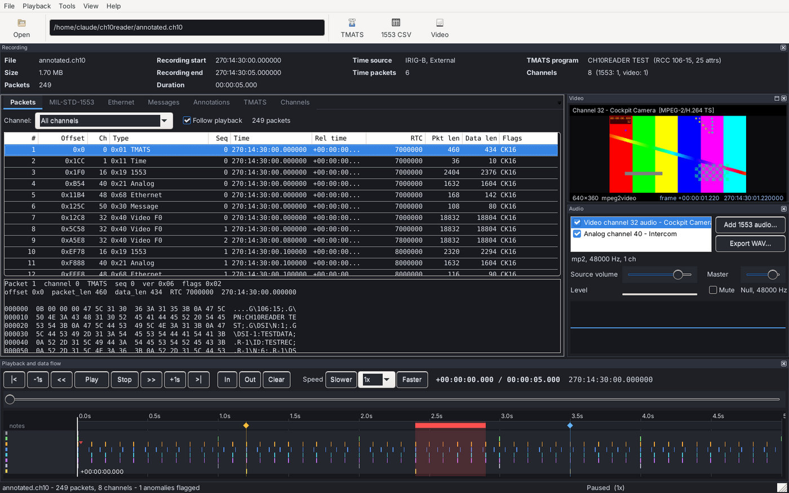
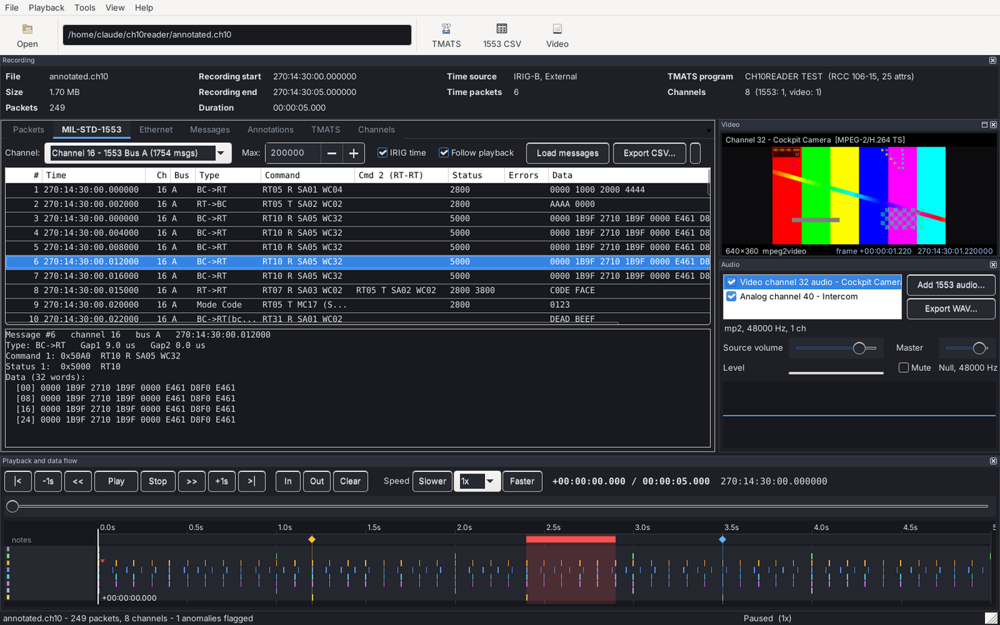
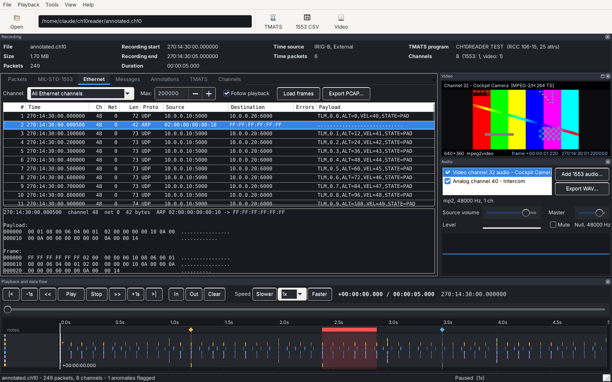

# ch10reader

**IRIG 106 Chapter 10 telemetry workbench — C++17, CMake, wxWidgets, FFmpeg**

[](https://github.com/fullylaced/ch10reader/actions/workflows/ci.yml)


A reader, analyser, editor and player for IRIG 106 Chapter 10 flight-test recordings. One
dependency-free core library (`ch10core`) decodes the packet layer byte-for-byte per the
IRIG 106-15 spec; a CLI (`ch10dump`) and a desktop workbench (`ch10gui`) sit on top of it.
Every pane in the workbench follows one playback clock, so scrubbing the timeline moves the
video, the 1553 bus traffic, the Ethernet frames and the audio together.



<table><tr>
<td></td>
<td></td>
</tr><tr>
<td align="center"><sub>MIL-STD-1553: command/status word decode, data words, word-map naming</sub></td>
<td align="center"><sub>Ethernet F0: MAC / VLAN / IPv4 / UDP / ARP parsing, PCAP export</sub></td>
</tr></table>

### Highlights

- **Spec-exact decoding** of TMATS, Time F1, MIL-STD-1553 F1, Video F0/F1, Analog F1, Ethernet F0/F1 and Message F0, with section numbers cited next to each field in the source.
- **Robust to damage**: every header checksum is verified, and a destroyed packet is skipped by scanning forward to the next valid sync — the rest of the file still reads.
- **A writer, not just a reader**: cut, split, merge (with RTC rebasing and channel remapping), inject annotations, free-text messages and real 1553 messages from a text file, all as valid Chapter 10 packets other tools accept.
- **Synchronised playback** from 0.1× to 16× in both directions: FFmpeg video, miniaudio mixing of Analog F1 / transport-stream / 1553-data-word audio, and a heat-row timeline with annotation and anomaly markers.
- **Tested end to end**: a synthetic, spec-conformant file generator plus a CTest suite that exercises every CLI operation on Linux (GCC) and Windows (MSVC) in CI.

### Quick start

```bash
# Linux (Ubuntu 24.04): full build with GUI
sudo apt install cmake g++ libwxgtk3.2-dev libavformat-dev libavcodec-dev libswscale-dev libavutil-dev
cmake --preset linux && cmake --build --preset linux-release -j
./build/linux/ch10gui recording.ch10

# Any platform, no GUI dependencies: core library + CLI + tests
cmake -B build -DBUILD_GUI=OFF && cmake --build build -j && ctest --test-dir build

# No recorder file handy? Make a spec-conformant one (1553, time, analog, Ethernet, messages):
python3 tools/make_test_ch10.py demo.ch10 && ./build/ch10dump demo.ch10 --m1553
```

Windows (Visual Studio 2022 + vcpkg) instructions are in [Building on Windows 11](#building-on-windows-11-gui--cli).

---

## Format support

Cross-platform (Linux / Windows) C++17 reader for IRIG 106 Chapter 10 files.
Implements the common packet layer plus the packet types needed first:

| Data type | Ch10 code | Support |
|---|---|---|
| Computer-Generated F1 (TMATS setup record) | 0x01 | Full parse: CSDW, raw text export, attribute key/value list, channel map (`R-x\TK1/DSI/CDT`) |
| Time F1 (IRIG/GPS/RTC) | 0x11 | Full decode (day and DMY BCD formats); used to convert RTC timestamps to absolute time |
| MIL-STD-1553 F1 | 0x19 | Full decode: CSDW, IPTS, IPDH (block status/gap/length), command/status word decode, BC→RT / RT→BC / RT→RT / mode codes / broadcast, error flags, CSV export |
| Video F0 (MPEG-2/H.264) | 0x40 | CSDW decode; transport-stream extraction to playable `.ts` files |
| Video F1 (ISO 13818-1 MPEG-2) | 0x41 | CSDW decode (TS/PS, profile/level, IPH, KLV); extraction to `.ts` / `.mpg` |
| Video playback | - | FFmpeg decode of any transport-stream channel to RGB frames on the RTC clock (`ch10::VideoStream`) |
| Recording Events (Format 2) | 0x02 | Read as timeline markers, with descriptions looked up in TMATS `R-x\EV\D-n` |
| Annotations (Format 0, user-defined) | 0x00 | Free-text notes/ranges stored as `CH10ANN1` packets on channel 0xA550 (42320) - written and read by this tool, ignored gracefully by others |
| File operations | - | Cut/filter (time range, channels, data types, 1553 RT/SA/direction/errors), split by duration or size, merge with RTC rebasing and channel remapping (`ch10::Cut/Split/Merge`) |
| Anomaly detection | - | Sequence gaps, RTC-sync and overflow flags, 1553 block-status errors, resync points - flagged on the timeline and listed with the annotations |
| Analog F1 (audio) | 0x21 | CSDW decode (SAME/FACTOR/TOTCHAN/SUBCHAN/LENGTH/MODE), unpacked and byte-packed samples, rate from TMATS `R-x\ASR-n-m` or measured; playback and WAV export |
| Audio in video streams | - | The audio track muxed inside a Video F0/F1 transport stream, decoded with FFmpeg and played in sync |
| Audio in 1553 data words | - | User-defined mapping (channel/RT/SA/direction/word range, 16-bit, 8-bit or G.711) with the sample rate derived from message cadence |
| Ethernet F0 | 0x68 | Frame ID word decode (errors, speed, NetID, content); MAC/VLAN/IPv4/UDP/TCP/ARP parsing; PCAP export for Wireshark |
| Ethernet F1 (ARINC-664) | 0x69 | IPDH decode (VL, IPs, ports); PCAP export synthesises the MAC/IP/UDP headers |
| Message Data F0 | 0x30 | Serial/free-form messages listed as text (complete and segmented packets) |
| User data injection | - | Text file -> annotation packets, Message F0 text packets and real 1553 messages (hex or ASCII data words); new channels described in TMATS |
| 1553 word map | - | CSV naming and scaling data words (u16/s16/u32/s32/f32/hex/bin/ascii) shown in the message detail |

Everything else is recognized and counted in the summary (Table 10-10 names),
so adding a new decoder is just one more module.

All parsing is done with explicit little-endian byte decoding — no packed
structs, no memory-mapped casts — so the same code is correct under MSVC,
GCC, and Clang on any architecture. File I/O is plain `std::ifstream` with
64-bit offsets (files > 4 GB are fine on both platforms).

## Layout

```
include/ch10/   public headers (packet, reader, writer, tmats, time_f1, ms1553_f1,
                video, video_stream, audio, ethernet, message_f0, wordmap,
                userdata, session, annotation, ops)
src/            ch10core library + ch10dump CLI (main.cpp)
gui/            ch10gui: app, main_frame (AUI layout), playback (clock), theme,
                timeline_panel, video_panel, packets_panel, ms1553_panel,
                ethernet_panel (Ethernet + Messages tabs), annotations_panel,
                tool_dialogs (cut / split / merge / user data),
                audio_engine (miniaudio mixer), audio_panel
third_party/    miniaudio.h (public domain / MIT-0) for audio output
tools/          make_test_ch10.py + testpattern.ts - generate a test recording
CMakePresets.json  ready-made configure/build presets (Windows + vcpkg, Linux)
vcpkg.json      manifest: tells vcpkg to build wxWidgets for the GUI
```

The parsing code is built as a static library `ch10core`. `ch10dump` (CLI)
and `ch10gui` (wxWidgets) are both thin front ends over `ch10::Session`, so
any decoder added to the library shows up in both.

## Building on Windows 11 (GUI + CLI)

You need Visual Studio 2022 with the C++ tools, Git, and vcpkg. wxWidgets and
FFmpeg are **not** Windows components; vcpkg downloads and compiles them the
first time you configure, driven by this project's `vcpkg.json`.

1. Check that Visual Studio's CMake component is installed. Open
   **x64 Native Tools Command Prompt for VS 2022** from the Start menu and run:

   ```bat
   cmake --version
   ```

   If it prints a version, go to step 2. If it says `cmake` is not recognized,
   open **Visual Studio Installer** > Modify > *Individual components*, tick
   **C++ CMake tools for Windows**, and apply. (Both are part of the
   *Desktop development with C++* workload; the workload is all you need.)

2. Install vcpkg once and point `VCPKG_ROOT` at it. In the same prompt:

   ```bat
   git clone https://github.com/microsoft/vcpkg.git C:\vcpkg
   C:\vcpkg\bootstrap-vcpkg.bat
   setx VCPKG_ROOT C:\vcpkg
   ```

   `setx` only affects new windows, so close this prompt now.

3. Unzip the project (say to `C:\dev\ch10reader`), open a fresh
   **x64 Native Tools Command Prompt for VS 2022**, and configure with the
   preset. This step builds wxWidgets and FFmpeg into
   `build\windows\vcpkg_installed` - allow 30-60 minutes the first time;
   afterwards it takes seconds.

   ```bat
   cd C:\dev\ch10reader
   cmake --preset windows-vcpkg
   ```

4. Build in Release:

   ```bat
   cmake --build --preset windows-release
   ```

5. Run. vcpkg places the wxWidgets and FFmpeg DLLs next to the executable:

   ```bat
   build\windows\Release\ch10gui.exe
   build\windows\Release\ch10dump.exe recording.ch10
   ```

Or, after step 2, open the folder in Visual Studio (File > Open > Folder),
choose the **Windows x64 (Visual Studio 2022 + vcpkg)** preset in the toolbar,
set `ch10gui.exe` as the startup item and press F5.

Troubleshooting:

- *"Could not find a package configuration file provided by wxWidgets"* -
  `VCPKG_ROOT` is not set in this prompt (open a new one after `setx`), or the
  vcpkg install failed; re-run `cmake --preset windows-vcpkg` and read the
  error at the bottom of `build\windows\vcpkg-manifest-install.log`.
- Resource compiler error mentioning `wx.rc` - remove `gui/app.rc` from the
  `GUI_SOURCES` list in `CMakeLists.txt`; you lose only the themed-controls
  manifest.
- To build without video playback (skips the FFmpeg build):
  `cmake --preset windows-vcpkg -DENABLE_VIDEO_PLAYBACK=OFF`.
- CLI only, no wxWidgets: `cmake -B build -DBUILD_GUI=OFF` then
  `cmake --build build --config Release`.

## Building on Linux

1. Install the toolchain, wxWidgets and FFmpeg development packages
   (Debian/Ubuntu):

   ```bash
   sudo apt install build-essential cmake pkg-config libwxgtk3.2-dev \
        libavformat-dev libavcodec-dev libswscale-dev libavutil-dev
   ```

2. Configure and build with the Linux preset:

   ```bash
   cd ch10reader
   cmake --preset linux
   cmake --build --preset linux-release -j
   ```

3. Run:

   ```bash
   ./build/linux/ch10gui recording.ch10
   ./build/linux/ch10dump recording.ch10
   ```

## Using the GUI

The window is a dockable workspace (drag pane captions to rearrange, float or
close them; *View > Reset layout* restores the default):

- **Recording** (top) - file name and size, packet count, TMATS program and
  Chapter 10 version, recording start / end / duration on the IRIG clock,
  time source and format, channel counts.
- **Packets** tab - every packet in the file (virtual list, so millions of
  rows are fine) with offset, channel, type, sequence, IRIG time, relative
  time, RTC, lengths and flags. A channel filter, a hex dump of the selected
  packet body, and *Follow playback* which keeps the packet at the cursor in
  view.
- **MIL-STD-1553** tab - channel picker, message table (errored messages in
  red), full decode of the selected message, CSV export, *Follow playback*.
- **TMATS** tab - the setup record text (export from the toolbar).
- **Channels** tab - per-channel summary coloured by data type.
- **Video** (right) - one live view per video channel, decoded from the
  transport stream inside the Chapter 10 packets and time-stamped on the
  recording's RTC clock. The bottom bar of each view shows resolution,
  codec and the current frame's recording time.
- **Playback and data flow** (bottom) - transport controls, position slider,
  and the timeline: one heat row per channel showing bytes recorded over
  time, with the cursor drawn across it. Click or drag on the timeline to
  seek.

Transport: `|<` start, `-1s`, `<<` rewind, `Play`/`Pause`, `Stop`, `>>` play
forward, `+1s`, `>|` end, and speed: `Slower` / `Faster` buttons or the
selector (0.1x, 0.25x, 0.5x, 0.75x, 1x, 1.5x, 2x, 4x, 8x, 16x). Keyboard: Space
or F5 play/pause, F6 stop, F7 rewind, F8 forward, `[` slower, `]` faster,
Ctrl+Left/Right step, Home/End. Every pane follows the same cursor, so a
rewind at 4x walks the video, the packet table, the 1553 table and the audio
backwards together. At high speeds the video decoder works within a
per-frame budget so the UI never stalls; it catches up within a moment.

**Audio** (Audio pane): when a recording opens, analog channels and the
audio tracks inside video channels are listed automatically; *Add 1553
audio...* defines a source from PCM carried in 1553 data words (channel,
RT/SA/direction, word range, 16-bit / 8-bit / G.711 formats; sample rate
derived from the message cadence or set by hand). Tick sources to hear them,
set per-source and master volume, mute, watch the level meter and the
scrolling waveform. Audio is rendered on the playback clock at the current
speed and direction - slow motion plays low and slow, fast forward high and
fast, rewind plays backwards - and stays locked to the video and bus data.
*Export WAV...* writes the selected source (the In/Out range if set) as
16-bit mono WAV. Output goes through miniaudio: WASAPI on Windows, ALSA or
PulseAudio on Linux.

Timing of video and audio frames: when the recorder flags SRS (SCR/PCR
locked to the RTC) frames are placed by their PTS exactly; otherwise the
PTS-to-RTC offset is learned as a median over the first frames after a seek,
which keeps playback smooth while staying anchored to the packet times.

**In/Out range**: `In` / `Out` (keys I / O) mark a range at the cursor; it is
shaded on the timeline and pre-fills the Cut dialog and range annotations.

**Themes**: View > Theme > Dark / Midnight / Light. The choice is saved
(registry on Windows, `~/.ch10gui` on Linux). With wxWidgets 3.3+ on Windows
the native title bar and menus follow the dark setting after a restart.

**Annotations** (Annotations tab, Ctrl+M): point or range notes with a
severity (Note, Warning, Anomaly, Marker) and an optional channel. They draw
as diamonds/bands in the "notes" strip of the timeline; hover for the text,
click to select. Anomalies the scanner detected (sequence gaps, RTC-sync and
overflow flags, 1553 block-status errors, resyncs) show as red ticks in their
channel's row and in the same list; *Keep anomaly* turns one into a real
annotation. Annotations live in memory until you write them: *Save to file
copy...* (or Tools > Save annotations into a file copy) writes a new
recording with each annotation as a Computer-Generated Format 0 packet on
channel 42320 (0xA550). Reopen that copy - here or in any later version -
and the markers are back. The packet layout is documented in
`include/ch10/annotation.h`; other Chapter 10 tools list the packets at the
right time and skip the payload.

**Ethernet tab**: frames of a channel with parsed headers (MAC, VLAN, IPv4,
UDP, TCP, ARP), error bits from the frame ID word, a payload preview, and hex
+ ASCII dumps of the payload and whole frame; *Export PCAP...* writes the
channel (or all Ethernet channels) as a classic libpcap file for Wireshark.
ARINC-664 (Format 1) messages get synthesised MAC/IP/UDP headers so their
payload dissects normally. Timestamps are absolute when the recording has a
time packet (day-of-year files count from 1970-01-01 since the year is not
recorded).

**Messages tab**: Message Data (Format 0) packets - the spec's container for
serial/free-form messages such as GPS NMEA lines - listed as readable text
with a hex dump, following playback like the other tables.

**Readable data you supply** (Tools > Add user data from text file...): write
a plain text file (Write template... gives you an annotated example) and the
tool produces a new recording containing your data as real packets:

```
1.500,        note, warning, "Check RT5 wraparound here"      -> annotation packet
2.000-2.400,  note, anomaly, "Burst of retries on bus A"       -> range annotation
0.500,        text, 200, "FLIGHT LOG: pad idle, GPS 3D fix"    -> Message F0 packet on channel 200
1.250,        1553, 16, A, 7, R, 3, 0041 0042 0043 0044        -> 1553 message, hex data words
1.300,        1553, 16, A, 7, R, 4, "HELLO FROM THE PAD"       -> 1553 message, ASCII in the words
```

Times are seconds from the start or absolute `DDD:HH:MM:SS.mmm`. New
channels are added to the TMATS setup record (`R-x\DSI/TK1/CDT`), so any
Chapter 10 tool lists them with a name. Injected 1553 messages are complete
transactions (command, data, status words) that the 1553 tab decodes like
any other, and the detail pane shows the ASCII reading of the data words.

**1553 word map** (1553 tab > Word map..., or Tools > Load 1553 word map):
a CSV mapping channel/RT/SA/direction/word index to a name, type, scale,
offset and units (`Write word map template...` for the format). Matching
messages show their words decoded by name in the detail pane, e.g.
`altitude = 2048 m`. The map path is remembered between runs.

**Tools menu**:

- *Cut / filter to new file...* (Ctrl+T) - time range (defaults to In/Out),
  channel checklist, and a 1553 message filter (RT addresses, subaddresses,
  direction, errored only). Filtered 1553 packets are rebuilt with the kept
  messages and a corrected CSDW, checksum and length, so the output stays
  spec-conformant and much smaller. Setup record and time packets are always
  kept; a time packet from just before the range is included so IRIG time
  still correlates.
- *Split into parts...* - by duration or by size. Each part starts with the
  setup record and a time packet.
- *Merge recordings...* - any number of files. When every file has a Time F1
  packet they are aligned on absolute time (each file's RTC is rebased onto
  the first file's clock, and the intra-packet time stamps of 1553, video,
  event and annotation packets are rewritten accordingly); otherwise they are
  concatenated with a one-second gap. Channel IDs of later files get an
  offset (automatic: next multiple of 100 above the previous file's highest
  ID) and their TMATS `R-x` sections are appended as `R-(x+n)` with `TK1`
  channel numbers adjusted. Limitation: PCM, ARINC-429, analog and other
  packet types with IPTS layouts this tool does not parse keep their original
  IPTS values (header times are correct).

How video seeking works: decoding runs forward from the current position.
Backwards or jump seeks restart the decoder two seconds before the target and
decode up to it; a bounded cache of recently decoded frames (96 MB per
channel) makes short backward scrubs free. Frame times are exact to the
Chapter 10 packet that carried the frame (100 ms or better on a compliant
recorder).

## CLI usage

```
ch10dump <file.ch10>                 per-channel packet summary
ch10dump <file.ch10> --tmats         print the TMATS setup record
ch10dump <file.ch10> --tmats t.txt   export TMATS to a file
ch10dump <file.ch10> --m1553         human-readable 1553 message listing
ch10dump <file.ch10> --m1553 o.csv   export 1553 messages to CSV
ch10dump <file.ch10> --video out     extract video channels to out_chN.ts / .mpg
ch10dump <file.ch10> --snapshot 2.5 f.ppm   decode the video frame 2.5 s into the file
ch10dump <file.ch10> --annotations   list annotations, events and detected anomalies
ch10dump <file.ch10> --ethernet [--channel N] [--max N]  list Ethernet frames
ch10dump <file.ch10> --pcap lan.pcap [--channel N]      export frames for Wireshark
ch10dump <file.ch10> --messages [--channel N]           list Message F0 packets as text
ch10dump <file.ch10> --m1553 --wordmap map.csv          decode data words by name
ch10dump --inject-template data.txt                     write the user data example
ch10dump --wordmap-template map.csv                     write the word map example
ch10dump in.ch10 --cut out.ch10 --inject data.txt       add notes/text/1553 from the file
ch10dump <file.ch10> --wav a.wav --channel 40            analog channel to WAV
ch10dump <file.ch10> --wav v.wav --channel 32            audio track of a video channel
ch10dump <file.ch10> --wav b.wav --channel 16 --rt 10 --sa 5 [--fmt s16] [--rate 8000]

ch10dump in.ch10 --cut out.ch10 --from 10 --to 25 --channels 16,32
ch10dump in.ch10 --cut out.ch10 --rt 5,7 --sa 1 --tr T --errors-only
ch10dump in.ch10 --cut out.ch10 --severity warning --annotate "RT5 dropout@12.5" \
                                --annotate "retry burst@13-13.4"
ch10dump in.ch10 --split parts --every 60          # parts_part01.ch10, ...
ch10dump in.ch10 --split parts --max-mb 512
ch10dump a.ch10 --merge merged.ch10 b.ch10 c.ch10 [--channel-offset 100|auto]
        --channel <id>               restrict to one channel ID
        --max <n>                    stop after n 1553 messages
        --no-time                    raw RTC seconds instead of absolute time
```

1553 listing example:

```
#3  ch16  270:14:30:00.015000  bus A  RT->RT   RT07 R SA03 WC02  <- RT05 T SA02 WC02
        status1 0x2800 RT05
        status2 0x3800 RT07
        data    C0DE FACE
```

CSV columns: `msg_index, channel, time, bus, type, rt, tr, sa, wc_mc, cmd1,
cmd2, status1, status2, errors, gap1, gap2, word_count, data_hex`. Error
flags use the spec's block-status abbreviations (ME, FE, TO, WC, SE, WE),
joined with `|`.

## Testing without a recorder file

```bash
python3 tools/make_test_ch10.py test.ch10
./build/ch10dump test.ch10 --m1553
```

The generator emits a TMATS record, an IRIG-B time packet, and six 1553
transactions (BC→RT, RT→BC, RT-to-RT, transmit mode code with data,
broadcast, and a response-timeout error) with correct header and 16-bit data
checksums.

## Robustness notes

- Header checksums are verified on every packet (10.6.1.1.j). On a bad or
  missing header the reader scans forward for the next valid `0xEB25` sync
  with a passing checksum and sane length fields, and reports the resync
  count.
- Setup records spanning multiple packets are concatenated before parsing.
- If packet flag bit 6 selects secondary-header time for intra-packet time
  stamps, all three formats are handled (Ch4 binary-weighted, IEEE 1588,
  ERTC); otherwise the 48-bit RTC is correlated against the first Time F1
  packet.

## Spec references

Field layouts follow IRIG 106-15 (Part 1), Chapter 10: Table 10-8 (packet
header), 10.6.1.2 (secondary header), 10.6.1.4 (trailer/data checksum),
10.6.3.2 (Time F1), 10.6.4.2 (1553 F1, Figures 10-22 through 10-25),
10.6.7.2 (setup record CSDW), 10.6.7.3 (Recording Events), 10.6.9.1 (Message
F0), 10.6.10.1 (Video F0), 10.6.10.2 (Video F1), 10.6.15.1 (Ethernet F0),
10.6.15.2 (Ethernet F1), 10.6.5.2 (Analog F1).
Section numbers are
cited in the source comments next to each decode.
